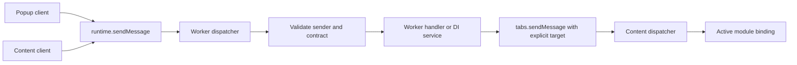
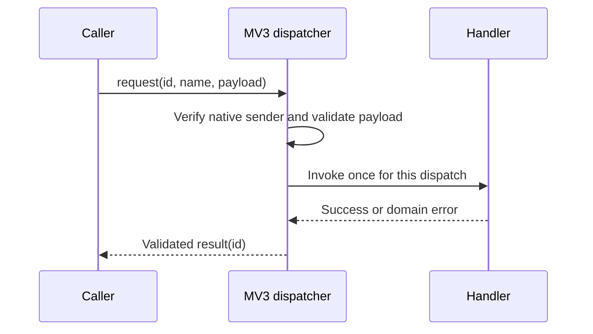
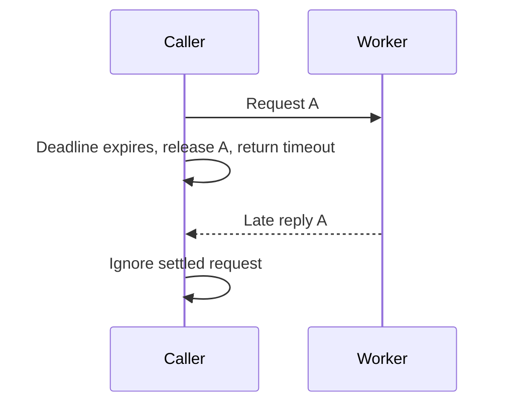
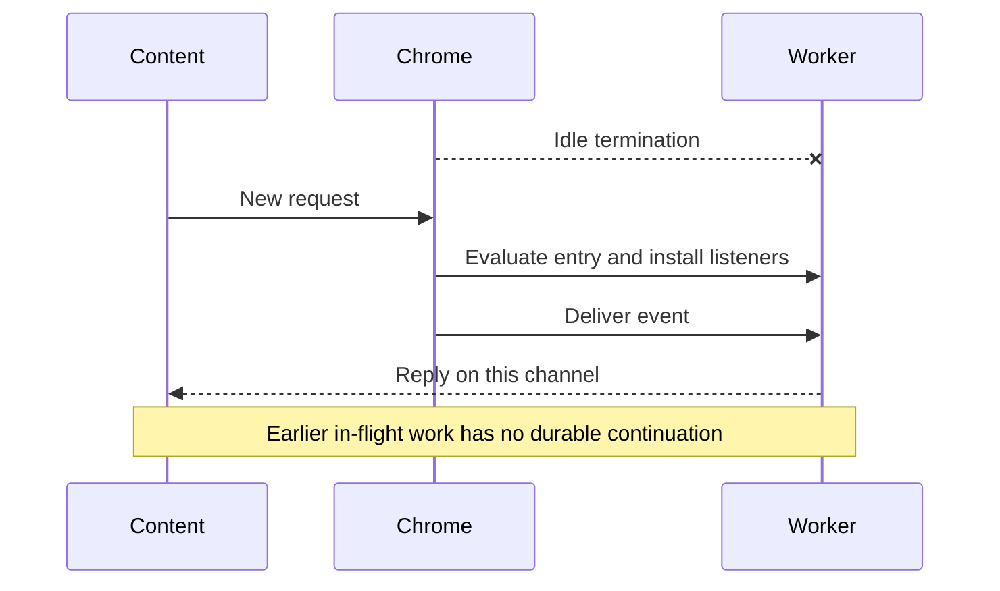

# ADR-001 · One-shot typed messaging for Chrome MV3

**Status:** transport strategy accepted for implementation. Implementation is pending. All names and signatures below are design sketches for an independent npm consumer. Baseline DevEx exports none of the proposed messaging helpers.

## Decision and alternatives

Adopt **C, a small internal adapter for Chrome's one-time message APIs**, with a typed public contract, one dispatcher per receiving realm and existing DevEx module ownership. The deciding requirement is safe addressing across navigation. A reply-triggered action can target the initiating document using its browser-supplied documentId. A tab/frame pair alone can refer to a different document by the time the action executes. The receiving endpoint must also be able to distinguish a known DevEx protocol with an inactive binding from unrelated traffic.

| Strategy | What DevEx would own | Decision |
| --- | --- | --- |
| A. Use a library directly | Consumers still need to standardize authorization, validators, owner disposal, destination policy and domain errors. Quickest for simple trusted request/response. | Insufficient as the framework contract. |
| B. Wrap @webext-core/messaging | Reuse callback handling, frame delivery, listener cleanup and error plumbing. A single reserved library message carrying a DevEx envelope could support dispatch and explicit missing-handler replies. | Supports frame-level routing. Version 4.0.2 delivered to the replacement document when supplied the old documentId alongside a valid frameId. DevEx requires document targeting. |
| C. Internal Chrome adapter | Implement Chrome callback and lastError handling, destination selection, one protocol discriminator, safe reply decoding and listener removal. DevEx still owns cancellation and authorization under any strategy. | Accepted for precise destinations and predictable coexistence. Cost is Chrome-specific maintenance and real-browser tests. Start with zero new runtime dependencies. Validators may adapt an author's existing schema library. |

Ports, streams, subscriptions, page bridges and cross-extension messaging require separate decisions on resource ownership, reconnection and backpressure.

## Proposed contract

A shared contract module contains pure validators and message specifications. Import it from both sides. A schema consumes unknown and either produces a validated JSON value or fails. Use strict object fields, bounded strings/arrays and finite numbers. Reject undefined, nonfinite numbers, exotic prototypes and values that Chrome could silently coerce. Void acknowledgements use an explicit JSON null on the wire. Each request declares allowed caller roles, destination role, payload, success and domain-error schema. Each event declares its payload, roles and no application reply.

```ts
// Proposed public subpath. The application supplies the schemas.
import { defineProtocol, event, request } from 'devxtension/messaging'
import { changed, highlight, highlighted, lookup, missing, summary } from './schemas'

export const review = defineProtocol('review', 1, {
  lookup: request({
    from: ['content', 'popup'], to: 'background',
    payload: lookup, response: summary, error: missing
  }),
  highlight: request({
    from: ['background'], to: 'content',
    payload: highlight, response: highlighted, error: missing
  }),
  changed: event({ from: ['content'], to: 'background', payload: changed })
})
// lookup parses { id: string }, summary parses { title: string },
// missing parses { code: 'missing', id: string }. Literals retain their types.
```

For a client specialized to a role, request keys are filtered to requests whose allowed caller union includes that role. For a selected key K, the types of payload, destination and Result come from that same definition. Use a discriminated tuple union over K to retain correlation when names are variables. Handler maps use the inverse filter on destination. Derive the handler's sender union from allowed caller roles. Reject duplicate namespace/version/name ownership during synchronous registration. Use the exact constructor/DI key registered by the existing ServiceDecorator.

```ts
type Destination =
  | { role: 'background' }
  | { role: 'content', tabId: number, frameId: number, documentId?: never }
  | { role: 'content', tabId: number, documentId: string, frameId?: never }

type Sender =
  | { role: 'content', tabId: number, frameId: number, documentId: string, origin: string }
  | { role: 'popup', url: string }
  | { role: 'background', extensionId: string }

type FailureCode = 'invalid' | 'forbidden' | 'unsupportedVersion' | 'noHandler'
  | 'unavailable' | 'channelClosed' | 'timeout' | 'aborted' | 'handlerFailed'
type Result<R, E> = { ok: true, value: R }
  | { ok: false, kind: 'domain', error: E }
  | { ok: false, kind: 'messaging', code: FailureCode }

// Content or popup. Options are local and never serialized.
const result = await client.request('lookup', { id: 'a1' }, { role: 'background' }, { signal })
if (result.ok) render(result.value.title)
else if (result.kind === 'domain') showMissing(result.error.id)
else showTransportStatus(result.code)

// Background, handling a verified request from a content document.
if (sender.role === 'content') {
  await workerClient.request('highlight', { id: 'a1' }, {
    role: 'content', tabId: sender.tabId, documentId: sender.documentId
  })
}
// A deliberate action for the current main frame uses { role: 'content', tabId, frameId: 0 }.
// Fire-and-forget at the application layer. No typed business response.
void client.notify('changed', { id: 'a1' }, { role: 'background' }).then(recordDispatch)
```

A popup obtains `review.client('popup')` in its entry and can call lookup. Its type excludes changed. A content client uses `review.client('content')`. A worker client uses `review.client('background')`. The role argument selects local ergonomics only. The receiver derives identity from Chrome. notify returns a Promise of dispatch status (admitted or a messaging failure). Admission is a transport acknowledgement before event processing and cannot confirm completion. Callers may ignore this settled result. A suspended worker can lose unfinished event work. Use a request for work whose completion matters.

## Author-facing registration options

**1. Module-owned bindings backed by DI.** A proposed helper returns a widget class accepted by today's module decorator. Create the class once, outside setup. The helper's setup binds handlers and its teardown releases exactly its own registrations. A local widget participates in the existing module ownership/refcount rules. The callback resolves the feature's current service and never stores a tab or activation on the DI singleton.

```ts
const ReviewCommands = review.contentWidget({
  highlight: ({ payload }) =>
    dependencyContainer.getService<typeof ReviewService>(ReviewService.name).highlight(payload.id)
})

@ModuleDecorator({
  url: 'https://example.com/*',
  vanilla: { mainService: ReviewService },
  widgets: [ReviewCommands]
})
class ReviewModule {}

createExtensionFactory([ReviewModule])({ params: { manifest } })
```

**2. Declarative handler definitions.** Prefer this for the worker. Pure definitions can also be bound by the first option in a content realm. Handlers return a validated success or domain failure. The same function can delegate to a decorated service in the worker's own JS realm.

```ts
// src/messaging/background.ts, evaluated once per worker start
import { review } from './contract'
import { findSummary } from './catalog'

review.background({
  lookup: async ({ payload, sender }) => {
    const entry = await findSummary(payload.id, sender)
    return entry
      ? { ok: true, value: { title: entry.title } }
      : { ok: false, kind: 'domain', error: { code: 'missing', id: payload.id } }
  },
  changed: ({ payload }) => recordChange(payload.id)
}, { contentOrigins: ['https://example.com'], popupPath: '/popup.html' })
```

Install the listener synchronously, before any async initialization. An accepted handler may await initialization subject to its request deadline. Worker termination discards registrations and realm-local DI instances. Re-evaluation recreates them from the entry. No tab teardown, popup close or route transition unregisters the global worker table. A popup sending requests needs no receiving listener. Route departure releases the module binding and invalidates replies owned by that activation. A later activation receives a new ownership token. Roll back partially registered groups on collision. Shared widget owners release by reference count; distinct widgets claiming the same key fail explicitly. Keep the protocol endpoint available at document scope while the factory is alive for explicit noHandler replies after deactivation. A proposed factory-wide widget in params.widgets can own that endpoint using existing setup/teardown. If no endpoint is installed Chrome may report unavailable instead. The final factory owner removes the root listener. A dispatcher table maps names to callbacks and owns no services.

## Wire and trust boundary



Each envelope carries a reserved DevEx marker, protocol namespace, version, destination role, request/event kind, random request ID, name and data. A response echoes the protocol, version and ID, with exactly one success, domain failure or messaging failure variant. Validate both directions. A runtime listener seeing unrelated traffic or the wrong destination returns synchronously without claiming the reply. This preserves the existing route message and legacy user backgrounds. For accepted async requests return literal true and settle sendResponse once. A missing owned name is an explicit noHandler only after authenticating the caller. A supported namespace with an incompatible version may return unsupportedVersion. Ignore foreign protocols.

- Require sender.id equal to chrome.runtime.id. Classify content from browser-provided tab/frame/document plus an explicitly allowed HTTPS or configured local development origin. Parse URLs, check scheme, compare exact origins and reject opaque/inconsistent origins, unexpected frames and missing required identity. Default to top-frame callers; an iframe requires an explicit policy. Check authorization per handler and per requested resource after parsing. An allowed origin alone cannot authorize a privileged operation.
- Classify popup from the exact packaged extension URL and expected popup context. Accept worker-origin commands only with browser-provided evidence identifying the packaged background entry. Verify actual metadata on supported Chrome versions. Where metadata cannot distinguish roles, fail closed and revisit the capability before release. Never treat a caller-provided role, tabId, URL, namespace or request ID as a credential.
- Replies to content-initiated follow-up actions target its browser-derived tabId + documentId. Explicit frame addressing intentionally selects the current occupant of that frame. Do not pass a payload-controlled target to tabs.sendMessage. A tab-only convenience must resolve to frame 0. No broadcast or forwarding arbitrary Chrome method names.
- Register internal onMessage only. No externally_connectable, onMessageExternal, window.postMessage listener, host permission expansion or new tabs/scripting/storage permission for transport. Popup/policy origins cannot expand the existing Manifest's injection scope. Cap body size, nesting depth and per-sender outstanding work before invoking application code. Reject malformed data and unknown object keys. Return sanitized codes with correlation IDs. Keep stack traces and raw payloads out of wire errors and default logs.

## Timing, failures and delivery







| Condition | Observable result and ownership |
| --- | --- |
| No receiving context, closed tab, navigated document | Explicit unreachable native target maps to unavailable. Ambiguous native errors or channel loss after dispatch map conservatively to channelClosed. Do not infer that the handler never ran from Chrome's error text. |
| Handler absent, rejects, throws, returns malformed data | An authorized active dispatcher returns noHandler, a declared domain error, handlerFailed, or invalid as appropriate. Unexpected exceptions are sanitized locally. |
| Timeout or AbortSignal | Default deadline 5 seconds, configurable per send. Already-aborted signals prevent sending. After submission, local deadline/abort settles once, releases timers and signal listeners, ignores late responses and leaves remote work with an unknown outcome. No distributed cancellation in MVP. |
| Parallel sends, route teardown, reload | Independent IDs and timers. No cross-request ordering. Teardown settles local pending requests as aborted, invalidates outgoing handler completions, and declines new work for that activation. Dev Reload installs a new generation. In-flight channels can close, and a fresh generation never inherits their pending map. |
| Repeated send or restart mid-write | Best effort, one native send per call, zero or one accepted handler per valid endpoint dispatch. End-to-end exactly-once and durable delivery are unavailable. A second call can repeat side effects. Durable idempotency keys, storage and transaction policy belong to the application. |

Automatic retries: none in MVP, including timeout and channel loss. Invalid, forbidden, version, schema and domain failures require an input/policy change. A caller may explicitly retry a read after an endpoint becomes available, with a fresh correlation ID and bounded backoff. Retrying a command with uncertain outcome requires an application idempotency policy. Epoch-bound document targets must never silently fall back to a replacement frame.

## Accepted implementation constraints

1. Use the minimal native Chrome transport (strategy C).
2. Address a specific document with tabId + documentId.
3. Address the current frame occupant with tabId + frameId.
4. End delivery on stale-document failure. A frame fallback can reach a different document.
5. Register background listeners synchronously at worker startup.
6. Validate payloads at runtime in addition to TypeScript checks.
7. Send once per call in the MVP. Caller-initiated replay is an application decision.
8. Use existing DevEx DI and module lifecycle for handler ownership.
9. Default request deadline is five seconds.
10. Notification acknowledgement confirms admission. Completion requires a request.

### Open integration questions

- Validate the generated worker and popup entry integration, including packaging, CSP and legacy background fragments.
- Verify role identification and fail-closed policy with the generated worker URL and supported popup contexts. Exercise additional frame and origin cases in the packed consumer.
- Prove module/shared-widget ownership, rollback and listener cleanup with real DevEx lifecycle transitions.
- Set production payload and concurrency budgets and confirm the browser floor with installed-consumer coverage.

### Feasibility evidence

On Windows 10, Chromium 141 and Chrome 158 both kept the iframe frameId across navigation and assigned a new documentId. Native Chrome rejected the stale document and the replacement handler saw zero calls. Explicit frame targeting reached the replacement document. The library exposed the same Chrome sender fields but did not enforce document targeting. Content senders included tab, frame and document metadata. Real popup and worker senders exposed id, origin and url, with different packaged paths. After CDP-confirmed stop, both transports woke a new worker and received a reply to the first send. Strict TypeScript 5.1.6 passed all nine negative checks. The experiment used an isolated fixture and controlled worker stop. Windows 11, natural idle and production integration remain verification gates. [Stage 2A feasibility report](https://github.com/Kiril-Hr/extension-2.0/blob/75bdfe62c82964967c23f79ed6800b8accbad860/reports/devex-025/STAGE_2A.md)

### Type inference boundary for review

The proposed declaration below shows how to keep a variable name tied to the corresponding payload and destination. Protocol inference normalizes each validated request to a Spec. RequestKeys filters by caller and request kind. Target maps background to its singleton address and content to either explicit tab/frame or tab/document. NotifyKeys and EventArgs use the same construction for event names and return admission status. SenderOf maps a specification's allowed roles into the Sender union. Validator.parse accepts unknown at both sides of the browser channel.

```ts
interface Validator<T> {
  parse(value: unknown): T
}

type Role = Sender['role']
type Spec = {
  from: Role
  to: 'background' | 'content'
  kind: 'request' | 'event'
  payload: unknown
  response: unknown
  error: unknown
}
type Protocol = Record<string, Spec>
type RequestKeys<P extends Protocol, R extends Role> = {
  [K in keyof P]: R extends P[K]['from']
    ? P[K]['kind'] extends 'request' ? K : never
    : never
}[keyof P]
type Target<S extends Spec> = Extract<Destination, { role: S['to'] }>
type SenderOf<S extends Spec> = Extract<Sender, { role: S['from'] }>
type Options = { timeoutMs?: number, signal?: AbortSignal }
type Args<P extends Protocol, K extends keyof P> = {
  [N in K]: [name: N, payload: P[N]['payload'], target: Target<P[N]>, options?: Options]
}[K]
interface RequestClient<P extends Protocol, R extends Role> {
  request<A extends Args<P, RequestKeys<P, R>>>(
    ...args: A
  ): Promise<Result<P[A[0]]['response'], P[A[0]]['error']>>
}
```

Contract constructors infer schema output types and preserve literal from/to roles. Review this signature against the packaged TypeScript compiler during the first approved spike. The protocol namespace is unique per consumer application and independent of Chrome's extension ID. ID matching is correlation only.
