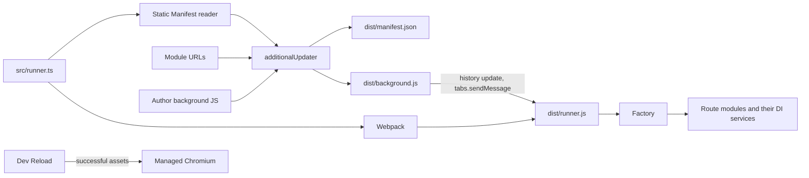

# DEVEX-025 · Typed messaging architecture

Design review against `main@a6beed848201bf80dcfac6fb4756a0eac710ce0d`. The audit describes shipping code at that commit. The proposed consumer contract and its acceptance gates are in [ADR-001](ADR-001.md) and the [implementation plan](IMPLEMENTATION_PLAN.md).

## The existing path

| Source in packages/runtime | Observed behavior | Integration consequence |
| --- | --- | --- |
| [webpack.configuration.js](../../packages/runtime/lib-bild/config/webpack.configuration.js), [additionalUpdater.js](../../packages/runtime/lib-bild/config/webpackCompileUtils/additionalUpdater.js) | The beforeCompile hook runs the generator. mergeBackgrounds combines the configured URL updater and plain JS in src/extensionOptions/backgrounds, minifies the result and writes background.js. The Manifest points at that classic MV3 worker. | TypeScript handlers with imports need an explicit worker compilation path. Dropping TS into the existing JS directory cannot provide this. |
| [backgroundURLUpdater.js](../../packages/runtime/lib-bild/config/webpackCompileUtils/backgroundURLUpdater.js) | A top-level history listener filters main-frame events, sends __DEVEX_ROUTE_CHANGED__ to the tab, and can reload a matching tab when delivery fails. | Keep this private protocol independent. Its reload-on-entry behavior would be inappropriate for an application request. |
| [createExtensionFactory.ts](../../packages/runtime/src/core/createExtensionFactory.ts) | Autostart installs a content-side runtime listener plus popstate/hashchange listeners. The route message invokes reSetup when the URL changes and receives an acknowledgement. teardown removes the listeners. A second invocation of the same configured factory tears down the previous controller. | Reuse module setup/teardown for logical registrations. The DOM factory reads window.location and cannot bootstrap a worker. |
| [ExtensionCoreModule.ts](../../packages/runtime/src/core/coreModule/ExtensionCoreModule.ts), [ExtensionConfigurator.ts](../../packages/runtime/src/core/coreModule/ExtensionConfigurator.ts), [DI](../../packages/runtime/src/core/dependencyContainer/dependencyContainer.ts) | Core constructs selected modules, rolls back failed setup, tears down outgoing modules and recreates them on reSetup. DI service instances persist within the realm. Widgets and manifest participants use shared ownership. | Store a route binding's disposer on its module instance. Resolve business services from existing DI. A shared service owning an unqualified current tab or a single disposer would mix owners. |
| [factoryManifest.js](../../packages/runtime/lib-bild/config/webpackCompileUtils/factoryManifest.js), [Webpack dev](../../packages/runtime/lib-bild/config/webpack.dev.js), [Webpack prod](../../packages/runtime/lib-bild/config/webpack.prod.js) | Both configs bundle the consumer runner. The generator reads static Manifest data without executing consumer code. | Author schemas and functions are executable imports in their own entry bundle. Retain static Manifest extraction. A declared popup HTML and its script still need an actual asset/build entry. |
| [dev.js](../../packages/runtime/lib-bild/devex-scripts/dev.js), [chromium.js](../../packages/runtime/lib-bild/devex-scripts/chromium.js) | Successful builds snapshot the generated Manifest, background.js and Webpack assets. Reload waits for activation of a fresh worker version at /background.js. | Preserve the public worker filename. A worker compilation or handler import failure must invalidate the whole watch result. Old pending requests cannot migrate to the replacement worker. |

## Upstream comparison

Source review on 2026-11-23. The linked source revisions identify what was inspected. Upstream issue reports are leads for tests, not reproductions on DevEx.

| Option | Types, transport and failures | Chrome MV3 and DevEx fit |
| --- | --- | --- |
| @webext-core/messaging | Function protocol map derives payload and return types. Extension adapter chooses runtime.sendMessage or tabs.sendMessage with tabId/frameId, passes Chrome's MessageSender, reads lastError, and uses callback responses. Generic dispatcher registers one root listener lazily, rejects duplicate names, returns disposers, serializes exceptions and ignores unmatched names. | Closest match. Register synchronously during worker evaluation. Inspected extension send options omit documentId. Missing responses do not distinguish an absent route binding from an absent endpoint. DevEx must supply validation, authorization, deadline and ownership. [Extension adapter](https://github.com/aklinker1/webext-core/blob/0f18863337250fe6db02ff0a88b8a0fce3a375af/packages/messaging/src/extension.ts) · [Dispatcher](https://github.com/aklinker1/webext-core/blob/0f18863337250fe6db02ff0a88b8a0fce3a375af/packages/messaging/src/generic.ts) |
| webext-bridge | Context entrypoints and typed protocol maps over runtime Ports. Background routes messages by endpoint, tab and frame. Per-context transactions correlate replies and serialized errors. Disconnect logic reconciles pending deliveries and endpoint fingerprints. | Greater routing reach and connection state than this one-shot MVP requires. An in-memory pending transaction cannot survive termination by itself. Public window bridging would add an unwanted trust boundary. [Background router](https://github.com/serversideup/webext-bridge/blob/df8746cf82d637fd53f1affb5f3455b1a2268f25/src/background.ts) · [Endpoint runtime](https://github.com/serversideup/webext-bridge/blob/df8746cf82d637fd53f1affb5f3455b1a2268f25/src/internal/endpoint-runtime.ts) |
| WXT messaging guide | Refers consumers to browser APIs or separately installed packages, including both libraries above. Types, transport, exceptions and restart behavior follow the chosen backend. | Adopting WXT would introduce a build-system migration without solving handler ownership. Its guide is applicable independently. [Guide](https://wxt.dev/guide/essentials/messaging) · [Built-in messaging proposal #643](https://github.com/wxt-dev/wxt/issues/643) |
| Native Chrome | One-time channels use runtime.sendMessage, tabs.sendMessage and runtime.onMessage. Chrome exposes sender metadata and tab/frame/document targeting. The browser API supplies no per-name application schema. Channel closure and absent receivers can produce delivery errors. | Synchronous top-level listener registration permits wake-up. Return literal true for an accepted asynchronous response on the Chromium 141 baseline. Unrelated listeners must decline synchronously since multiple contexts can receive a runtime message and only one response wins. Use a portable JSON subset. [Messaging](https://developer.chrome.com/docs/extensions/develop/concepts/messaging) · [tabs.sendMessage](https://developer.chrome.com/docs/extensions/reference/api/tabs#method-sendMessage) · [Chromium channel service](https://chromium.googlesource.com/chromium/src/+/HEAD/extensions/browser/api/messaging/message_service.cc) |

### Compatibility evidence

- webext-core's open [#168](https://github.com/aklinker1/webext-core/issues/168) requests Port abstractions. Its open [#85](https://github.com/aklinker1/webext-core/issues/85) concerns fake-browser serialization. Neither establishes a production Chrome one-shot failure. Use actual Chromium to test wire values.
- webext-bridge's open [#109](https://github.com/serversideup/webext-bridge/issues/109) reports an idle MV3 worker restarting with a persistent content connection. [#53](https://github.com/serversideup/webext-bridge/issues/53) requests a send timeout. These affect the choice of transport and are test cases if the Port option is revisited.
- Different browser versions handle Promise-returning listeners and propagated handler errors differently. Normalize error envelopes and use callback completion across the supported Chromium matrix. Browser metadata can be incomplete. Authorize only verified contexts. [Chrome compatibility notes](https://developer.chrome.com/docs/extensions/develop/concepts/messaging#responses) · [MessageSender](https://developer.chrome.com/docs/extensions/reference/api/runtime#type-MessageSender)

## Build proposal

Opt in by providing a conventional worker entry `src/messaging/background.ts`. Bundle its transitive imports as a classic, self-contained worker asset using the existing Webpack toolchain. Preserve the generated background.js bootstrap, execute the bundled asset via synchronous importScripts at worker evaluation, and include it in both prod and watch outputs. Keep legacy background fragments and route notifications operational. The Manifest still declares one worker. Bindings for content belong in ordinary feature modules. Popup senders import only the client and shared contracts from their own built entry. Stage 1 proposes no general popup bundler. Test a copied popup HTML/JS asset backed by an explicitly bundled consumer entry. Realm-safe imports, duplicate assets, CSP and watch invalidation are implementation gates.
